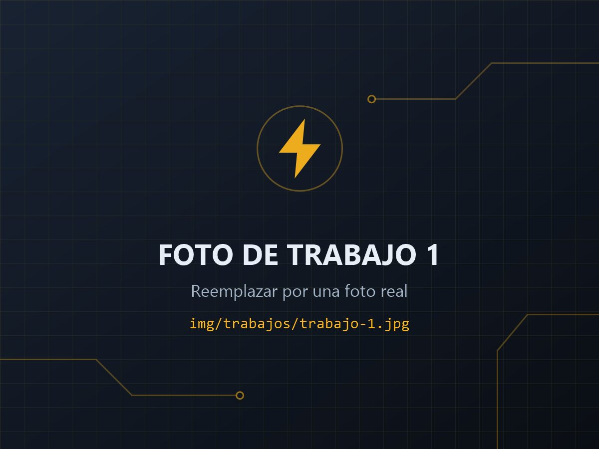

# Jaime Electricidad — Página web

Página de una sola hoja (landing) de **Jaime Electricidad**, electricista habilitado por ERSEP en Villa Carlos Paz y alrededores. Está hecha con HTML, CSS y JavaScript comunes, sin programas extra, y se publica gratis con **GitHub Pages**.

Este instructivo está pensado para alguien que **no programa**. Para cambiar casi todo alcanza con buscar una palabra y reemplazarla.

---

## 1. Qué hay en cada carpeta

| Archivo o carpeta | Para qué sirve | ¿Lo tengo que tocar? |
|---|---|---|
| `index.html` | Todos los textos y datos de la página | Solo para cambiar algún dato o texto |
| `img/trabajos/` | Fotos de los trabajos realizados | **Sí**, subí las fotos reales |
| `img/foto-perfil.jpg` | Foto de Jaime para la sección "Sobre mí" | **Sí** |
| `css/estilos.css` | Colores y diseño | Solo si querés cambiar colores |
| `js/main.js` | Animaciones y fotos ampliadas | No |
| `img/og-imagen.jpg` | Imagen que aparece al compartir el link | No (ya sirve así) |
| `img/favicon.svg` | Ícono de la pestaña (un rayo) | No |
| `.nojekyll` | Le avisa a GitHub que publique los archivos tal cual | No (no lo borres) |

---

## 2. Cómo editar un archivo

**Opción A — Desde la página de GitHub (sin instalar nada)**

1. Entrá al repositorio en github.com.
2. Apretá la tecla **punto (`.`)** del teclado. Se abre un editor en el navegador.
3. A la izquierda, hacé click en `index.html`.
4. Para buscar y reemplazar: **Ctrl + H** (en Mac: **Cmd + Option + F**).
   Escribí arriba lo que buscás, abajo lo nuevo, y tocá "Reemplazar todo".
5. Para guardar en GitHub: tocá el ícono de ramitas de la izquierda (Control de código fuente), escribí un mensaje corto como "Cambio teléfono" y tocá **Commit & Push**.

**Opción B — En tu computadora**

Abrí la carpeta con [Visual Studio Code](https://code.visualstudio.com/) (gratis) y usá **Ctrl + H** para buscar y reemplazar. Para ver cómo queda, hacé doble click en `index.html` y se abre en el navegador.

> 💡 En el código hay comentarios que dicen **`EDITAR`**. Buscá esa palabra con **Ctrl + F** y vas a ir saltando por cada dato que se puede cambiar.

---

## 3. Datos cargados y cómo cambiarlos

| Dato | Cómo está ahora | Para cambiarlo, buscá |
|---|---|---|
| Nombre de la empresa | Jaime Electricidad | `Jaime Electricidad` |
| Nombre en "Sobre mí" | Hola, soy Jaime | `soy Jaime` |
| Habilitación | Habilitado por ERSEP | `ERSEP` |
| Experiencia | Más de 10 años | `10 años` y `+10` |
| Zona | Villa Carlos Paz y alrededores | `Villa Carlos Paz` |
| Localidades | Lista en la sección "Zona de cobertura" | `ZONA DE COBERTURA` |
| Días | Lunes a sábado | `Lunes a sábado` |
| Horario | A coordinar | `A coordinar` |
| Teléfono que se lee | 3541 59-2372 | `3541 59-2372` |
| Número para llamar y para WhatsApp | 5493541592372 | `5493541592372` (ver punto 4) |

Para agregar o sacar localidades, en la sección "ZONA DE COBERTURA" copiá o borrá líneas como esta:

```html
<li>Villa Carlos Paz</li>
```

---

## 4. Teléfono y WhatsApp

Se usa el mismo número para llamadas y WhatsApp. Si alguna vez cambia, buscá **`5493541592372`** y reemplazalo en todo el archivo (aparece 6 veces: 3 botones de llamar y 3 de WhatsApp). Acordate de cambiar también el número que se lee (`3541 59-2372`).

El número va escrito **todo junto, sin espacios, guiones ni paréntesis**:
**549** + código de área **sin el 0** + número **sin el 15**.

| Número | Cómo va |
|---|---|
| (03541) 15 59-2372 | `5493541592372` |

> ⚠️ El **9** después del 54 es lo que indica que es un celular. Si se borra, el botón "Llamar" marca un número fijo y la llamada no llega. Si algún día se usa un **teléfono fijo** para llamadas, ahí sí va sin el 9 (por ejemplo `+543541123456`).

### Cambiar el mensaje que llega por WhatsApp

En los links de WhatsApp vas a ver `?text=Hola, quiero consultar por un trabajo eléctrico`. Podés cambiar lo que está después de `text=` por otro mensaje. Si lo cambiás, hacelo en los 3 lugares.

### Probarlo

Después de publicar, abrí la página **en tu celular** y tocá "Llamar" y "Escribir por WhatsApp" para confirmar que abren el número correcto.

---

## 5. Fotos de trabajos

Las fotos van en la carpeta **`img/trabajos/`**. Ahora hay 6 imágenes de muestra que dicen "FOTO DE TRABAJO 1", "2", etc.

### Reemplazar una foto (lo más fácil)

1. Renombrá tu foto exactamente igual que la de muestra: `trabajo-1.jpg`, `trabajo-2.jpg`, …
2. En GitHub entrá a la carpeta `img/trabajos`, tocá **Add file → Upload files**, arrastrá tus fotos y tocá **Commit changes**.
   Como tienen el mismo nombre, reemplazan a las de muestra.

**Reglas para los nombres de archivo:** todo en minúscula, sin espacios, sin acentos y terminado en `.jpg`.
GitHub distingue mayúsculas: `Trabajo-1.JPG` **no** es lo mismo que `trabajo-1.jpg`, y la foto no aparecería.

**Tamaño recomendado:** fotos horizontales, de unos 1200 píxeles de ancho y menos de 300 KB. Así la página carga rápido con datos móviles. Para achicarlas podés usar gratis [squoosh.app](https://squoosh.app/).

### Cambiar la descripción de cada foto

En `index.html`, buscá la sección "TRABAJOS REALIZADOS". Cada foto tiene dos textos:

```html

<figcaption>Tablero domiciliario</figcaption>
```

- **`alt="..."`**: describe la foto con una frase. La usan los lectores de pantalla (personas ciegas) y Google. Cambiala para que diga lo que muestra **tu** foto.
- **`<figcaption>`**: el título corto que aparece abajo de la foto.

### Agregar o sacar fotos

- **Sacar:** borrá el bloque completo desde `<li class="galeria__item revelar">` hasta su `</li>`.
- **Agregar:** copiá un bloque completo, pegalo abajo del último y cambiá el nombre del archivo **en los dos lugares** (`href="..."` y `src="..."`), por ejemplo `trabajo-7.jpg`. Después subí esa foto a `img/trabajos/`.

---

## 6. Foto de perfil

Reemplazá **`img/foto-perfil.jpg`** por la foto de Jaime, con el mismo nombre. Conviene que sea **vertical** (por ejemplo 800 × 1000 píxeles), con buena luz y la cara bien visible.

---

## 7. Mapa de Google Maps

Ya hay un mapa centrado en Villa Carlos Paz. Para cambiarlo, en `index.html` buscá `maps.google.com`:

```html
src="https://maps.google.com/maps?q=Villa+Carlos+Paz,+Cordoba,+Argentina&z=14&output=embed"
```

- **Otro lugar:** cambiá lo que está después de `q=` (los espacios se escriben con `+`).
- **Más cerca o más lejos:** cambiá el número de `z=14`. Más alto acerca, más bajo aleja.
- **Usar el código oficial de Google:** en Google Maps tocá **Compartir → Insertar un mapa → Copiar HTML** y reemplazá todo el `<iframe ...></iframe>` por lo que copiaste. No hace falta tocar el tamaño: la página lo acomoda sola.

---

## 8. Otros cambios comunes

- **Textos:** buscá la frase que querés cambiar con Ctrl + F y escribí encima. Cuidado de no borrar los signos `<` `>` ni las comillas `"`.
- **Servicios:** en la sección "SERVICIOS", cada servicio es un bloque `<li class="tarjeta revelar"> ... </li>`. Borrá el que no se haga o cambiá su título (`<h3>`) y su texto (`<p>`).
- **Color de acento:** en `css/estilos.css`, al principio, está `--acento: #ffb81c;` (ámbar). Ahí mismo hay una nota explicando cómo cambiarlo por otro color.

---

## 9. Publicar con GitHub Pages

1. En el repositorio, entrá a **Settings → Pages**.
2. En **Source** elegí **Deploy from a branch**.
3. En **Branch** elegí **main** y la carpeta **/ (root)**. Tocá **Save**.
4. Esperá uno o dos minutos. La página va a quedar en:

   **https://carlosvaldezalejandro.github.io/Jaime_Electricidad/**

Cada vez que guardes un cambio en GitHub, la página se actualiza sola en uno o dos minutos. Si no ves el cambio, recargá con **Ctrl + F5**.

> Con una cuenta gratuita de GitHub, el repositorio tiene que ser **público** para usar GitHub Pages.

### Imagen al compartir el link (opcional)

Cuando la página ya esté publicada, en `index.html` buscá `og:image`. Hay dos líneas comentadas: reemplazá `TU-USUARIO` y `TU-REPOSITORIO` por los de la dirección de arriba y borrá las marcas `<!--` y `-->` que las rodean. Así, al compartir el link por WhatsApp, aparece la imagen `img/og-imagen.jpg`.

---

## 10. Privacidad

La página no usa cookies, ni localStorage, ni herramientas de seguimiento propias. Lo único externo que se carga es de Google: las tipografías (Google Fonts) y el mapa de Google Maps, que puede guardar sus propias cookies.
